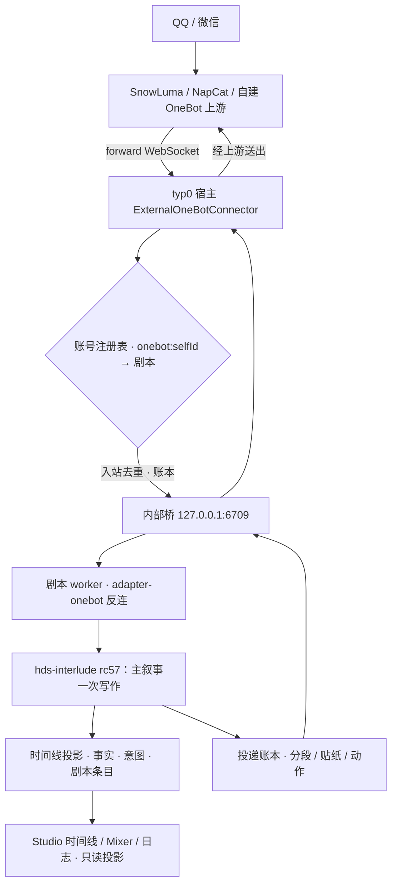

# HDS-Interlude Typ0 / 幕间系统桌面宿主

> 聊天在幕前发生，生活在幕间继续——Typ0 让这段生活住进桌面：多剧本、多账号，一次点击开演。

<p>
  
  
  
  
  
</p>

**[快速开始](#安装与运行) · [从插件版迁移](#从插件版迁移koishiyml-一键导入) · [主题包作者指南](THEME-PACK-AUTHOR-GUIDE.md) · [发行说明](RELEASE-NOTES.md) · [开发同步日志](docs/history/LOCAL-SYNC-LOG.md)**

交流群：421430402，群主24小时解答，欢迎来玩！

HDS-Interlude Typ0（typ0）是 [HDS Interlude / 幕间系统](https://gitee.com/MomoiCore/HDS-Interlude)的**桌面宿主**：它把 Koishi 运行时与 `koishi-plugin-hds-interlude`（哈希锁定 `1.0.1-rc57`，随仓库 `desktop/vendor/` 自带）装进一个 Electron 应用，让"持续叙事、流动时间与角色生活"不再需要自行部署 Koishi 实例——新建剧本、绑定 QQ 账号、接入模型，都在一个桌面界面里完成。

当前版本：`0.0.1-m4`。插件 artifact 溯源（双 SHA-256 + 源码树指纹）见 [PROVENANCE.md](PROVENANCE.md)。

## 文档导航

- 首次使用：本文 [快速开始](#安装与运行) + 应用内「首次使用向导」（新建剧本 6 步）
- 从插件版迁移：[从插件版迁移](#从插件版迁移koishiyml-一键导入)
- 自定义界面 / 主题包：[THEME-PACK-AUTHOR-GUIDE.md](THEME-PACK-AUTHOR-GUIDE.md)
- 桥接协议与版本政策：[BRIDGE_PROTOCOL.md](BRIDGE_PROTOCOL.md)
- 已知边界与数据边界：[RELEASE-NOTES.md](RELEASE-NOTES.md)
- 插件 artifact 溯源：[PROVENANCE.md](PROVENANCE.md)
- 架构与设计文档：[docs/design/](docs/design/)；历史批次与 UI 审计日志：[docs/history/](docs/history/)

## 它解决什么问题

插件版的 HDSI 已经解决了"角色如何拥有持续生活"；typ0 解决的是它外围的工程问题：

- **部署门槛**：不再需要安装 Koishi、建实例、配 YAML、装插件——新建剧本即一个完整运行环境；
- **单实例单剧本**：typ0 里**每个剧本是一个独立 Koishi worker 进程**，拥有自己的 canonical `koishi.yml` 与 SQLite 数据库；剧本之间互不干扰，可并行运行（受资源上限与同分支树互斥约束）；
- **账号与密钥管理**：QQ 账号在宿主层注册并绑定到剧本（selfId 全局唯一，可跨剧本转移）；API 密钥进系统安全存储（Electron safeStorage），配置里只留 `$secret:别名` 引用；
- **可观察与可干预**：桌面 Studio 提供 DAW 式时间线（剧本/收发/情绪/事实/日程轨道）、行为调音台、运行统计、诊断日志与就绪检查——角色的生活既是叙事，也是可以被阅读与审计的数据。

## 核心结构

### 每剧本一个 Koishi worker

新建剧本 = `stories/<id>/` 目录 + 模板 `koishi.yml`。加载时宿主 fork 一个 Koishi worker 子进程，用 config-compiler 把 canonical 配置编译成运行期配置（注入内部桥的 selfId / endpoint / 访问令牌）。卸载、重载、分支（fork）、备份都以剧本为单位；同一分支树同一时刻只允许一个活跃 worker。

### 内部 OneBot 桥 + 外部上游

worker 内的 `adapter-onebot` 反向连接宿主的内部桥（`127.0.0.1:6709`，令牌鉴权，不出本机）。宿主的 `ExternalOneBotConnector` 作为 forward WebSocket 客户端连接真正的消息上游（SnowLuma、NapCat 或自建 OneBot 服务），把入站消息按账号绑定路由进对应 worker，把角色的投递（分段消息、贴纸、动作）送回上游。bridge 协议版本协商与帧清单见 [BRIDGE_PROTOCOL.md](BRIDGE_PROTOCOL.md)。

### 配置权威与密钥边界

- canonical `koishi.yml` 是唯一配置事实；所有写入经 StoryConfigMediator：保存前自动备份、拒绝明文敏感键、校验 `$secret:` 别名存在；
- SecretStore 用 Electron safeStorage 加密存储密钥（开发模式 `HDSI_TEST_MODE=1` 才允许明文）；配置热改后由就绪检查提示「重载 Worker」（真正的 unload→load）；
- 就绪检查（连接页）逐项验证 Worker / 运行相位 / 渠道 / 模型密钥 / 账号 / 交往对象，并给出一键修复动作。

### Studio 界面

- **Arrangement 时间线**：Script / Receive / Send / Alter / Facts & Scenes / Schedule Preplan / Media / Compaction 轨道，时间尺度旋钮与 NOW 播放头，Shift+拖选可做区间删除（暂停相位下）；
- **Mixer 行为调音台**：节奏、上下文预算、Agency、记忆等参数的旋钮化调整（写回插件配置节）；
- **Session 剧本阅读 / Stats 运行统计 / 语义分析**；
- **诊断日志**：等级下拉（全部 / 仅 debug / info 及以上 / warn 及以上 / 仅 error）、来源/文本/correlation 筛选、Blind 沉浸模式开关、导出；
- **主题包**：L0 调色板 → L3 布局 DSL 的分层界面自定义（[作者指南](THEME-PACK-AUTHOR-GUIDE.md)），导入前本地校验 + 结构化诊断。

## 一次消息如何流动



暂停相位下的入站消息只进入收件箱排队（不触发写作），切回运行后可回放——就绪检查会明确提示。

## SnowLuma 边界（必读）

typ0 与 [SnowLuma](https://github.com/SnowLuma/SnowLuma) 是**进程级协作**：typ0 只做只读检测（安装目录 / 进程 / WebUI 状态）并把账号指向其 OneBot 上游。typ0 **不启动、不内嵌、不分发 SnowLuma**——SnowLuma 采用源码可见的非商业许可证（原生组件专有），与 AGPL-3.0 不兼容，代码级合并在法律上不可行。请自行运行 SnowLuma 的 launcher 后回应用内重新检测。详见 [RELEASE-NOTES.md](RELEASE-NOTES.md) 功能边界一节。

## 安装与运行

要求：Node.js ≥ 22（开发验证于 v24）、Windows（macOS/Linux 未验证；Linux 无 keyring 时密钥不可解密，就绪检查会给出指引）。

```bash
git clone https://github.com/ISEKAI-MomoiCore/HDS-Interlude-Typ0.git
cd HDS-Interlude-Typ0/desktop
npm install        # koishi-plugin-hds-interlude@1.0.1-rc57 随 desktop/vendor/ 自带
npm run build      # esbuild 编译主进程 + 渲染层
npm start          # 启动应用
```

开发循环：`npm run dev`（build + 启动）、`npm run typecheck`。

首次进入按应用内向导走 6 步（剧本信息 → 人设 → 模型 → 渠道 → 节奏 → 完成检查），或直接使用连接页「从 koishi.yml 导入」迁移插件版配置。

## 从插件版迁移（koishi.yml 一键导入）

连接页提供「从插件版导入 HDSI 配置」：

- 选择插件实例的 `koishi.yml`，本地解析（含嵌套 `group:*` 下的插件配置）并**脱敏预览**；
- 按模块勾选导入：人设 / 关系与白名单 / 账号 / 状态机 / 模型配置 / 行为节，主提示词默认不动、可选导入；
- 明文密钥直达 SecretStore（`migrated-*` 别名，同值复用），预览与报告不出现明文；
- 账号自动转移到新剧本（原剧本释放并标记 Idle，转移失败整体回滚）；旧版配置缺失 `useForMain` 时自动标记主叙事；
- 仅迁移配置，不迁移插件版数据库；新剧本以 paused 相位就绪，检查后一键开演。

## 使用要点

- **相位**：`Space` 在 运行 / 静音 / 暂停 间循环。静音 = 观察模式（写作但不发送）；暂停 = 入站只入收件箱，可回放；
- **配置热改**：保存后运行中的 worker 仍用旧配置，就绪检查会亮「重载 Worker」，一键真正重载；
- **备份与分支**：右键剧本可备份（一致性快照）与从时间线选点创建分支（fork 后截断）；删除剧本前自动备份进回收站；
- **插件市场**：插件面板支持搜索（npmmirror）、受控安装（`--ignore-scripts`）与嵌入式官方配置页（@koishijs/plugin-config）。

## 测试与开发

```bash
cd desktop
npm run typecheck
npm run test:runtime     # 主进程 75 项（node --test）
npm run test:smoke       # IPC 面具一致性冒烟（preload ↔ 注册表动态比对）
npm run test:importer    # koishi.yml 导入器 10 项
npm run test:ui          # Studio UI（puppeteer-core + Edge headless；UI_TEST_DIST=1 跑 dist）
```

另有 14 个专项 UI 套件（`npm run` 查看全部：providers / import / packs / config-lock / bugfix-round / theme / connect-layout…）。插件升级须同步更新 `desktop/vendor/` 的 tgz 与 [PROVENANCE.md](PROVENANCE.md) 的双哈希。

## 目录速览

```text
├─ README.md / RELEASE-NOTES.md / PROVENANCE.md / BRIDGE_PROTOCOL.md
├─ THEME-PACK-AUTHOR-GUIDE.md      # 主题包作者指南
├─ LICENSE                          # AGPL-3.0
├─ desktop/
│  ├─ src/main/                     # Electron 主进程（IPC 域模块 / 运行时服务）
│  ├─ src/renderer/                 # Studio 渲染层（app.js / 主题 / 校验器）
│  ├─ scripts/                      # 构建 + 全部测试
│  └─ vendor/                       # 哈希锁定的 hds-interlude rc57 tgz
└─ docs/                            # design/ 设计文档 · history/ 历史批次与同步日志
```

## 使用边界

typ0 依赖 HDSI 插件的写作与结构化输出能力；自动推进适合叙事陪伴，医疗、紧急救助、法律等高风险场景应使用专业服务。日志磁盘文件保留消息原文（脱敏仅在查询/导出边界），不要把数据目录分享给不信任的对象。完整边界清单见 [RELEASE-NOTES.md](RELEASE-NOTES.md)。

## 许可证

[AGPL-3.0](LICENSE)。`desktop/vendor/` 内的 `koishi-plugin-hds-interlude` 同为 AGPL-3.0（上游：[HDS-Interlude](https://gitee.com/MomoiCore/HDS-Interlude)）。SnowLuma **不在本仓库分发范围内**（见上文边界说明）。
